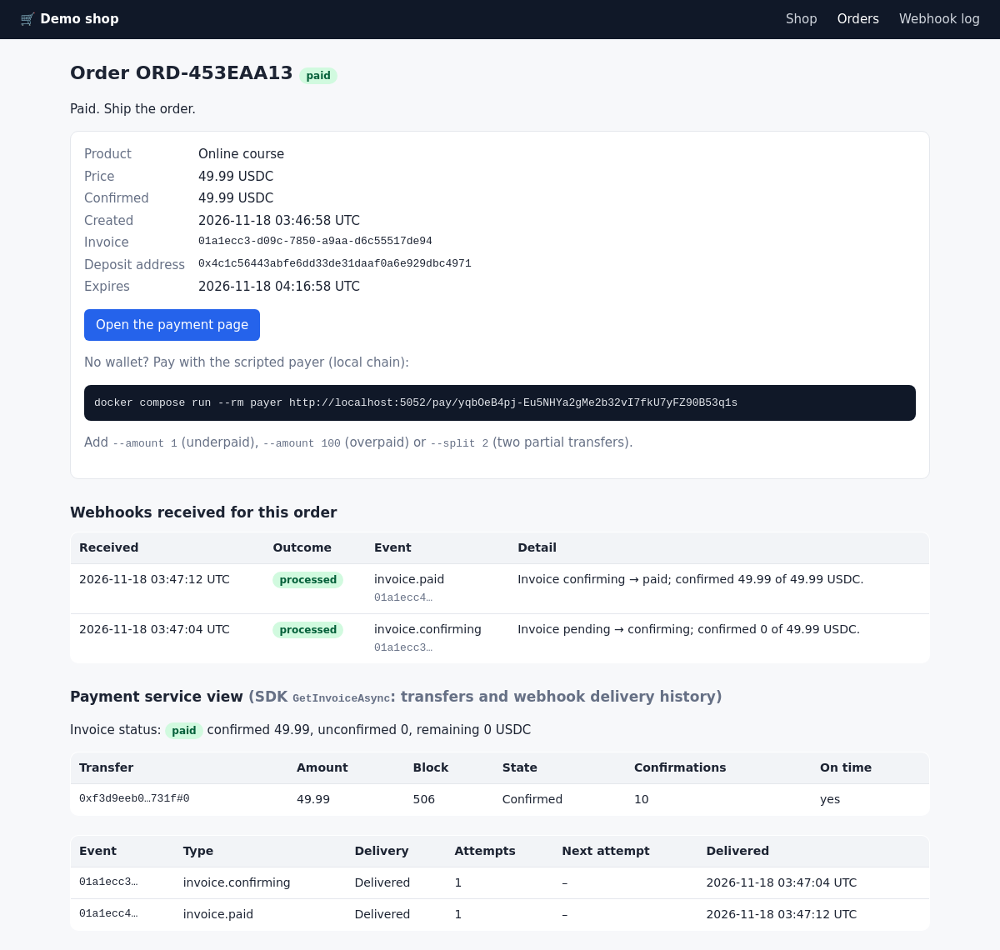
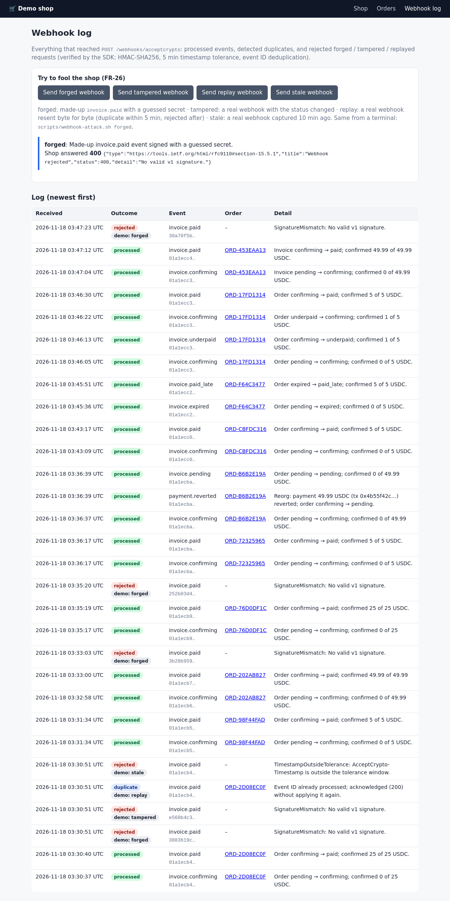

# accept-crypto-net

[](https://github.com/alena-dev-soft/accept-crypto-net/actions/workflows/ci.yml)
AcceptCrypto.NET — a non-custodial USDC payment SDK for ASP.NET Core applications, with invoice management, on-chain confirmation tracking and signed merchant webhooks.

> Status: early development — solution skeleton. See [docs/PROGRESS.md](docs/PROGRESS.md) and [docs/DECISIONS.md](docs/DECISIONS.md).

## Quick start: the whole cycle in one command

Requires Docker. No wallet, faucet or gas: a local chain with a test-only mock USDC and a scripted payer.

```bash
docker compose up --build                 # PostgreSQL, Anvil + mock USDC, the service, the demo shop
```

1. Open the demo shop at <http://localhost:5080> and click **Buy with USDC** → you land on the payment page.
2. Pay it: `docker compose run --rm payer http://localhost:5052/pay/<token>` (the URL of the payment page).
3. The page turns **confirming → paid**; the shop's order is **paid** and its webhook log shows the signed webhooks.

Underpay/overpay/late payment, stopping the shop or the service, forcing a reorg, forged/replayed webhooks and unmatched
transfers: [docs/demo.md](docs/demo.md). End-to-end check: `scripts/smoke-test.sh`.

| Demo shop | Webhook log (forged / replayed webhooks rejected) |
| --- | --- |
|  |  |

## Build & test

Requires the [.NET 10 SDK](https://dotnet.microsoft.com/download).

```bash
dotnet build AcceptCrypto.NET.slnx
dotnet test AcceptCrypto.NET.slnx
dotnet run --project src/AcceptCrypto.Service   # Development settings: /health, /scalar (API reference), /v1/*
```

Merchant REST API: see [docs/API.md](docs/API.md) (OpenAPI at `/openapi/v1.json`, UI at `/scalar`).
