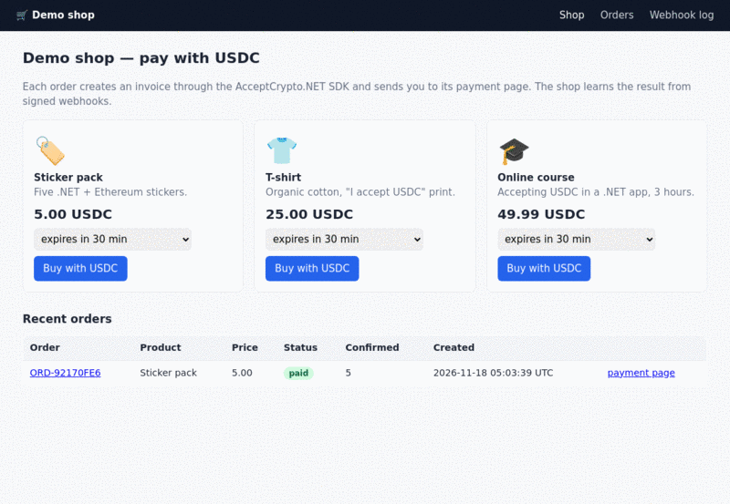
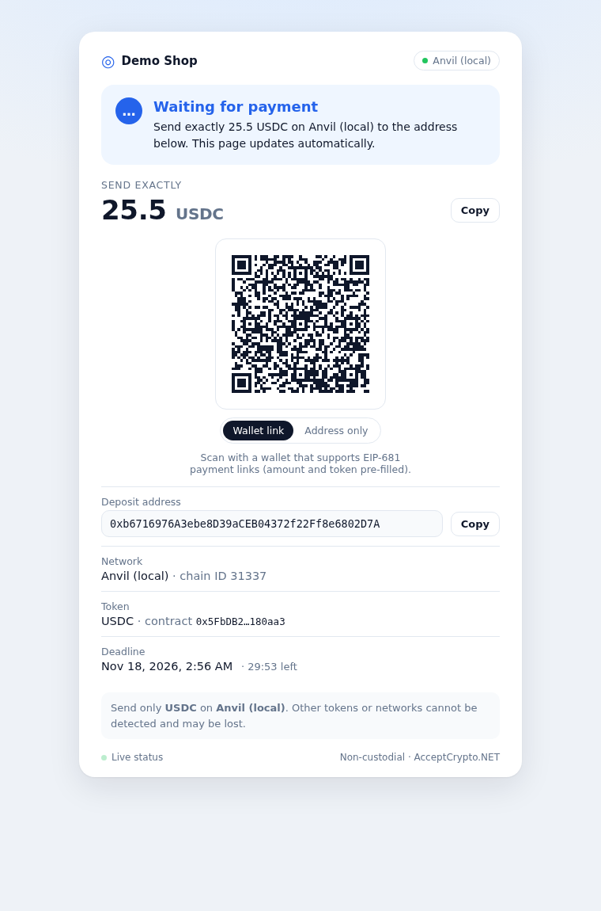
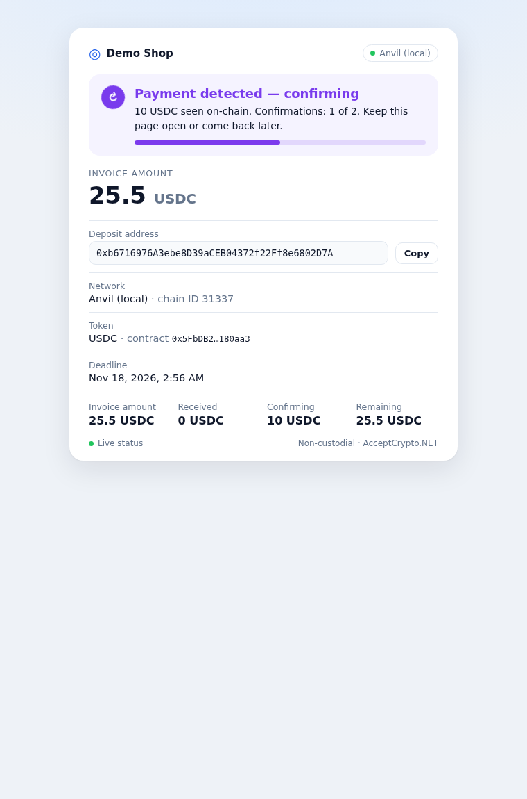
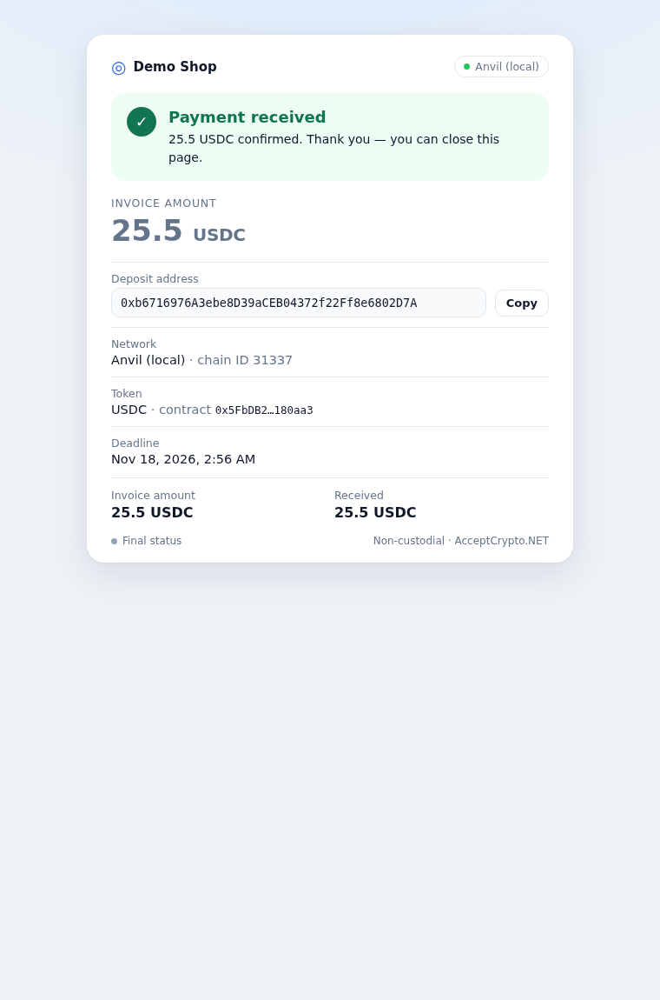
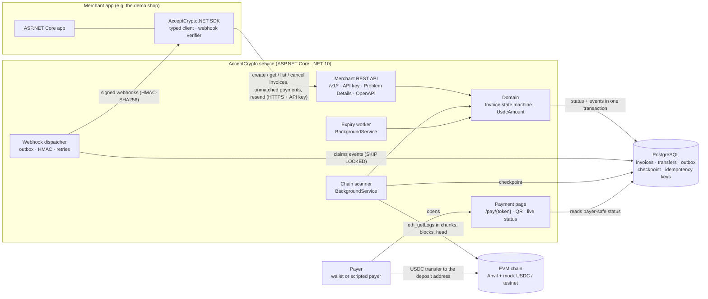
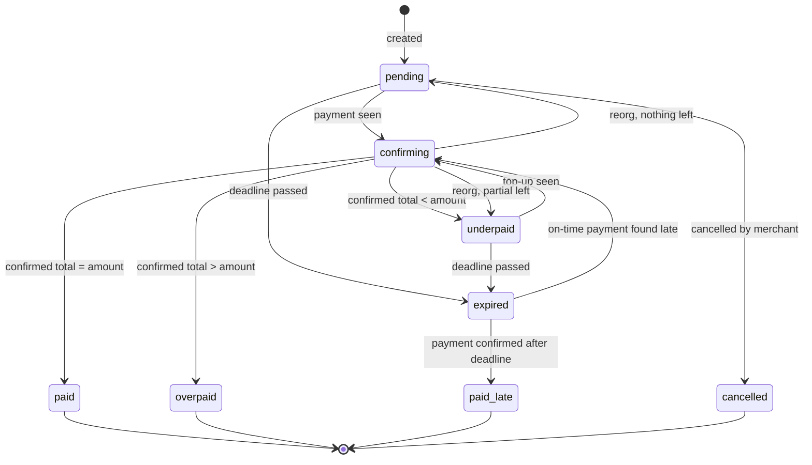

# AcceptCrypto.NET — non-custodial USDC payments for ASP.NET Core: a payment service + an SDK, plugged in with a few lines

[](https://github.com/alena-dev-soft/accept-crypto-net/actions/workflows/ci.yml)


The same model as Stripe + Stripe.net: the **service** creates invoices, watches the chain for USDC transfers, tracks
confirmations and reorgs, and sends signed, retried webhooks; the **SDK** (`AcceptCrypto.NET` NuGet package) gives
your ASP.NET Core app a typed client and one-line webhook verification. Every invoice gets its own deposit address
derived from the merchant's **xpub** — the service holds no private keys and never touches the funds.

> [!WARNING]
> **Portfolio / demo project. Local chain and testnets only — no mainnet, no real money.** All keys, secrets and the
> xpub in this repository are public test values.



<sub>The full cycle on the local stack: the demo shop creates an invoice through the SDK, the scripted payer sends
USDC, the payment page goes *confirming → paid*, the shop receives the signed webhooks. Recorded from a local run.</sub>

**Contents:** [Quick start](#quick-start-10-minutes-docker-only) ·
[Scenarios S1–S7](#walk-through-every-scenario-s1s7) · [Architecture](#architecture) ·
[How the hard parts are solved](#how-the-hard-parts-are-solved) · [SDK](#sdk-integrate-in-a-few-lines) ·
[Decisions](#decisions) · [Build & test](#build--test) · [Roadmap](#roadmap)

## Quick start (10 minutes, Docker only)

**Prerequisites:** [Docker](https://docs.docker.com/get-docker/) with Compose v2 (Docker Desktop includes it).
Nothing else: no .NET SDK, no wallet, no faucet, no gas. Ports 5052, 5080, 5432 and 8545 must be free.
(The optional helper scripts in `scripts/` need `bash` and `curl`; every step below also has a plain
`docker compose` / browser variant.)

```bash
git clone https://github.com/alena-dev-soft/accept-crypto-net.git
cd accept-crypto-net
docker compose up --build        # PostgreSQL, Anvil + mock USDC, the service, the demo shop (first build ~3–5 min)
```

The stack is ready when <http://localhost:5052/health/ready> answers `Healthy` (database, RPC and chain scanner) and
the shop opens.

| What | URL |
| --- | --- |
| Demo shop (a merchant app built on the SDK) | <http://localhost:5080> |
| Service: payment pages, merchant API, API reference | <http://localhost:5052/scalar> · OpenAPI `/openapi/v1.json` |
| Health / metrics | <http://localhost:5052/health/ready> · <http://localhost:5052/metrics> |
| Local chain (Anvil, chain ID 31337, a block every 2 s) | `http://localhost:8545` |

The **payer** is a scripted wallet (Anvil test account with 1,000,000 mock USDC). Run it in a second terminal:

```bash
docker compose run --rm payer <payment page URL>      # or: scripts/pay.sh <payment page URL>
```

The local stack waits for **5 confirmations** (≈ 10 s) and retries webhooks every 5 s → 30 s for 30 min (production
default ≈ 24 h). Reset everything: `docker compose down -v`. Check the whole cycle automatically (what CI runs):
`scripts/smoke-test.sh`.

**Public testnet (optional):** the same service and shop against **Base Sepolia** with Circle's test USDC, paid from
MetaMask — profile `appsettings.BaseSepolia.json`, `docker-compose.base-sepolia.yml`, step-by-step guide (RPC, own
xpub, faucets, video script) in [docs/testnet.md](docs/testnet.md).

## Walk-through: every scenario (S1–S7)

The scenarios are the spec's; each one is also an automated end-to-end test ([docs/TESTS.md](docs/TESTS.md)).
In the commands below, `<url>` is a payment page URL like `http://localhost:5052/pay/2bSOvO…`, and the API key is the
public test key of the compose stack.

```bash
KEY=dev_api_key_00000000000000000000000000000         # TEST ONLY (docker-compose.yml)
```

### S1 — create an invoice, open the payment page

From the shop: open <http://localhost:5080>, click **Buy with USDC** → you land on the payment page.

Or straight through the merchant API:

```bash
curl -s -X POST http://localhost:5052/v1/invoices \
  -H "X-Api-Key: $KEY" -H "Idempotency-Key: order-42" -H "Content-Type: application/json" \
  -d '{"amount": "10.50", "external_order_id": "order-42", "expires_in_seconds": 1800}'
```

The response holds `payment_page_url`, the deposit address, the exact amount and the deadline. Send the same request
again: the same invoice comes back (`200`, `Idempotent-Replayed: true`) — no second invoice (FR-2).

| Pending | Confirming | Paid |
| --- | --- | --- |
|  |  |  |

### S2 — pay the exact amount

```bash
docker compose run --rm payer <url>
```

The page switches to **Payment detected — confirming**, then **paid** after 5 blocks. In the shop, *Orders* → the
order is **paid**, and *Webhook log* shows `invoice.confirming` and `invoice.paid` as *processed*.

| Shop order (webhook applied) | Shop webhook log |
| --- | --- |
|  |  |

### S3 — wrong amount: less, more, in two parts

Use a fresh order (or invoice) for each line:

```bash
docker compose run --rm payer <url> --amount 1          # → underpaid (invoice stays open, page shows the remainder)
docker compose run --rm payer <url> --amount <rest>     # top-up of the remainder → paid
docker compose run --rm payer <url> --amount 100        # → overpaid (merchant decides; excess shown)
docker compose run --rm payer <url> --split 2           # two partial transfers → confirming → paid
```

### S4 — not paid in time, or paid after the deadline

In the shop, choose **expires in 2 min** before *Buy with USDC* (API: `"expires_in_seconds": 60` is the minimum of
the local stack). Wait for the deadline → the page shows **expired**. Then pay it anyway:

```bash
docker compose run --rm payer <url>                     # → paid_late (merchant decides whether to honour it)
```

A payment counts as on time by its **block timestamp**, not by when the service sees it.

### S5 — merchant down when the webhook is sent

```bash
docker compose stop demoshop
docker compose run --rm payer <url>        # pay an order you created before stopping the shop (or an API invoice)
docker compose logs -f service             # webhook delivery fails and is retried: 5 s, 10 s, 20 s, 30 s …
docker compose start demoshop              # the queued webhooks arrive in order; the order becomes paid
```

`GET /v1/invoices/{id}` shows every delivery attempt with its error.

### Service down during a payment (FR-8 / FR-9)

```bash
docker compose stop service
docker compose run --rm payer --to <deposit address> --amount <amount>   # the payment page is down too: pay by address
docker compose start service               # it scans the missed blocks from its checkpoint → paid, counted once
```

(Or pay first and stop the service within a few seconds. The deposit address and amount are on the payment page, the
shop's order page, or in the API response.)

### Forced chain reorganization (FR-10)

Pay, then drop the last 4 blocks **before the 5 confirmations are reached** (≈ 10 s) — the one-liner does it in time:

```bash
scripts/pay.sh <url> && scripts/pay.sh reorg 4
# without the script: docker compose run --rm payer <url> && docker compose run --rm payer reorg 4
```

The payment vanishes from the chain → the shop receives `payment.reverted` and `invoice.pending`; the invoice never
becomes paid. (If the page already showed *paid*, the reorg came too late — a confirmed payment is final by design.)

### Forged or replayed webhook (FR-26)

Open <http://localhost:5080/webhooks> and press the buttons, or from a terminal:

```bash
scripts/webhook-attack.sh forged      # made-up invoice.paid with a guessed secret      → 400 SignatureMismatch
scripts/webhook-attack.sh tampered    # genuine webhook, status edited                  → 400 SignatureMismatch
scripts/webhook-attack.sh replay      # genuine webhook resent byte for byte            → 200 duplicate, not applied
scripts/webhook-attack.sh stale       # genuine webhook captured 10 minutes ago         → 400 TimestampOutsideTolerance
curl -i -X POST http://localhost:5080/webhooks/acceptcrypto \
  -H "AcceptCrypto-Timestamp: $(date +%s)" -H "AcceptCrypto-Signature: v1=00" -d '{}'   # → 400
```

### S6 — invoice list and payment history

```bash
curl -s -H "X-Api-Key: $KEY" "http://localhost:5052/v1/invoices?status=paid&limit=10"   # cursor-paginated
curl -s -H "X-Api-Key: $KEY" http://localhost:5052/v1/invoices/<invoice id>               # transfers + webhook history
```

Or in the shop: *Orders* → an order shows the service's view through the SDK (transfers, confirmations, deliveries).

### S7 — a transfer that matches no open invoice

Send money to the deposit address of an invoice that is already closed (e.g. a paid order — the address is on the
shop's order page), then list unmatched payments:

```bash
docker compose run --rm payer --to <address of a paid invoice> --amount 1
curl -s -H "X-Api-Key: $KEY" http://localhost:5052/v1/unmatched-payments     # reason: invoice_closed
```

More payer commands: `payer mine 5` (mine blocks), `payer warp 3600` (move chain time), `payer balance`.
The full demo guide, also without Docker: [docs/demo.md](docs/demo.md).

## Architecture



- **Linking a payment to an invoice:** one deposit address per invoice, derived from the merchant's xpub (BIP32,
  index = invoice number). Plain transfers and QR codes work; partial, over- and late payments match naturally; no
  keys in the service ([D1](docs/DECISIONS.md#d1--payment--invoice-linking-one-deposit-address-per-invoice-xpub-derived)).
- **No message broker:** PostgreSQL + transactional outbox + `BackgroundService` workers
  ([D7](docs/DECISIONS.md#d7--storage-and-background-processing)).
- **Solution layout** (`src/`): `Domain` (no dependencies: money, invoice aggregate, state machine) ·
  `Infrastructure` (EF Core/PostgreSQL, scanner, webhooks, xpub derivation) · `Service` (API, payment page, hosting) ·
  `Sdk` (the NuGet package) · `DemoShop` (merchant app on the SDK) · `LocalChain` + `Payer` (Anvil helpers, scripted
  payer). Tests in `tests/`.

### Invoice lifecycle



| Status | Meaning | Terminal |
| --- | --- | --- |
| `pending` | Waiting for payment | no |
| `confirming` | A payment is seen, fewer than N confirmations | no |
| `underpaid` | Confirmed total below the amount; invoice still open | no |
| `paid` | Confirmed total equals the amount | yes |
| `overpaid` | Confirmed total exceeds the amount; merchant decides | yes |
| `expired` | Deadline passed; may hold a partial confirmed amount | no (late payment possible) |
| `paid_late` | Paid in full after the deadline; merchant decides whether to honour it | yes |
| `cancelled` | Cancelled by the merchant via the API while `pending` | yes |

Every transition is a webhook event (`invoice.<status>`); a reorg rollback also sends `payment.reverted`. Payments are
exact — no amount tolerance; money arriving at a closed invoice is recorded as an unmatched payment
([D5](docs/DECISIONS.md#d5--inexact-payments), [D6](docs/DECISIONS.md#d6--cancellation),
[D11](docs/DECISIONS.md#d11--domain-model-and-state-machine-edge-cases-step-2)).

## How the hard parts are solved

Each claim is backed by a test; the full scenario → test map is [docs/TESTS.md](docs/TESTS.md).

| Problem | How it is solved | Proving test |
| --- | --- | --- |
| **Double counting** (FR-8) — the same transfer seen twice after a restart, a re-scan or a reorg rollback | A transfer's identity is `(chain_id, tx_hash, log_index)`: the domain returns `Duplicate` for a known one, and PostgreSQL has a unique index on it (`ON CONFLICT DO NOTHING`), so re-scanning any range changes nothing | [`ScenarioTests.FR8_FR9_service_stopped_during_a_payment_finds_it_after_restart_and_counts_it_once`](tests/AcceptCrypto.IntegrationTests/EndToEnd/ScenarioTests.cs), [`TransferDeduplicationTests.Parallel_recording_of_the_same_transfer_stores_it_once`](tests/AcceptCrypto.IntegrationTests/Persistence/TransferDeduplicationTests.cs) — [TESTS.md](docs/TESTS.md#scenarios-and-definition-of-done) |
| **Missed payments after downtime** (FR-9) | The scanner persists a checkpoint (block number + hash) after every chunk and resumes from it; ranges are chunked (`MaxBlockRange`) and halved automatically when an RPC provider rejects them | [`ChainScannerTests`](tests/AcceptCrypto.IntegrationTests/Scanner/ChainScannerTests.cs) `.Payment_made_while_the_service_is_down_is_found_after_restart_in_chunks` — [TESTS.md](docs/TESTS.md#scenarios-and-definition-of-done) |
| **Reorgs** (FR-10) | A payment is final only after N confirmations. Until then, every pass re-reads the block of each unconfirmed transfer: a different hash reverts it (`payment.reverted` + the edge back to `pending`/`underpaid`) and rewinds the scan to find a re-included transaction. A changed checkpoint hash rolls the checkpoint back. Only positive evidence reverts; nothing confirms without a matching hash. Tested with a real forced reorg on Anvil (`anvil_reorg`) | [`ScenarioTests.FR10_forced_reorg_rolls_back_a_confirming_payment_and_never_produces_paid`](tests/AcceptCrypto.IntegrationTests/EndToEnd/ScenarioTests.cs), [`ChainScannerTests.Forced_reorg_rolls_back_a_confirming_payment_and_never_produces_paid`](tests/AcceptCrypto.IntegrationTests/Scanner/ChainScannerTests.cs) — [TESTS.md](docs/TESTS.md#scenarios-and-definition-of-done) |
| **Lost webhooks** (S5, FR-14/15/16) | Events live in a PostgreSQL outbox. The dispatcher claims them with `FOR UPDATE SKIP LOCKED` + a lease, delivers per invoice in causal order, retries with exponential backoff + jitter within a configurable limit and window, then marks them `failed`; a manual resend keeps the event ID. Each webhook carries a unique event ID so the merchant (SDK) drops duplicates | [`ScenarioTests.S5_merchant_down_when_the_webhook_is_sent_receives_it_once_it_is_back`](tests/AcceptCrypto.IntegrationTests/EndToEnd/ScenarioTests.cs), [`WebhookDeliveryTests.Parallel_dispatchers_deliver_every_event_exactly_once`](tests/AcceptCrypto.IntegrationTests/Webhooks/WebhookDeliveryTests.cs) — [TESTS.md](docs/TESTS.md#scenarios-and-definition-of-done) |
| **Status / event atomicity** (NFR-2) | The invoice row, its transfers and one outbox row per domain event are written by a single `SaveChanges` — one transaction. No status without an event, no event without a status | [`OutboxAtomicityTests.Status_change_and_its_events_are_committed_together_in_causal_order`, `…If_the_outbox_insert_fails_the_status_change_is_rolled_back`](tests/AcceptCrypto.IntegrationTests/Persistence/OutboxAtomicityTests.cs) — [TESTS.md](docs/TESTS.md#other-requirements) |
| **Concurrency** (NFR-3) — scanner, expiry worker and API touching one invoice | Optimistic concurrency: an explicit `version` token bumped on every aggregate change (also when only a child transfer changes); the unit of work reloads and re-applies the pure domain operation on conflict. Idempotency keys use `INSERT … ON CONFLICT` in the same transaction, so parallel creates return one invoice | [`ConcurrencyTests`](tests/AcceptCrypto.IntegrationTests/Persistence/ConcurrencyTests.cs) (`Parallel_confirmations_settle_to_the_correct_final_status`, `Racing_cancel_and_payment_never_produce_an_impossible_history`) — [TESTS.md](docs/TESTS.md#other-requirements) |
| **Precision** (NFR-1) | `UsdcAmount` = integer base units (`BigInteger`, 6 decimals); strict parsing of decimal strings (no exponent, ≤ 6 decimals); `numeric(78,0)` in PostgreSQL (fits uint256); amounts are JSON strings in the API, webhooks and SDK. No `double` anywhere | [`Domain.Tests/UsdcAmountTests`](tests/AcceptCrypto.Domain.Tests/UsdcAmountTests.cs), `Sdk.Tests/UsdcAmountAndDeduplicationTests` — [TESTS.md](docs/TESTS.md#other-requirements) |
| **SSRF** via the webhook URL (NFR-6) | The webhook URL is validated at startup (https, no internal IP literals or `localhost`), every resolved address must be public, and the HTTP handler re-resolves and checks the IP it actually connects to, so DNS rebinding cannot reach the internal network (loopback, private, link-local/cloud metadata, IPv4-mapped IPv6 …; no redirects, no proxy). Only hosts on an explicit allowlist (`Webhooks:AllowedHosts`, e.g. `demoshop` on the Docker network) may be internal | [`Infrastructure.Tests/Webhooks/WebhookUrlGuardTests`](tests/AcceptCrypto.Infrastructure.Tests/Webhooks/WebhookUrlGuardTests.cs), [`WebhookDeliveryTests.A_webhook_url_on_the_internal_network_is_refused_without_a_request`](tests/AcceptCrypto.IntegrationTests/Webhooks/WebhookDeliveryTests.cs) — [TESTS.md](docs/TESTS.md#other-requirements) |
| **Forged / replayed webhooks** (FR-13, FR-26) | HMAC-SHA256 over `{timestamp}.{body}`, compared in constant time; timestamp tolerance (default 5 min); several secrets accepted during rotation; duplicates detected by event ID | [`ScenarioTests.FR26_forged_tampered_and_replayed_webhooks_are_rejected_by_the_merchant_app`](tests/AcceptCrypto.IntegrationTests/EndToEnd/ScenarioTests.cs), [`Sdk.Tests/WebhookEndpointTests`](tests/AcceptCrypto.Sdk.Tests/WebhookEndpointTests.cs) — [TESTS.md](docs/TESTS.md#scenarios-and-definition-of-done) |

## SDK: integrate in a few lines

```csharp
using AcceptCrypto.Sdk;
using AcceptCrypto.Sdk.Webhooks;

var builder = WebApplication.CreateBuilder(args);
builder.Services.AddAcceptCrypto();   // binds "AcceptCrypto": BaseUrl, ApiKey, WebhookSecret (keep secrets out of the file)
var app = builder.Build();

// Checkout: create an invoice (idempotent) and send the customer to the payment page.
app.MapPost("/checkout/{orderId}", async (string orderId, IAcceptCryptoClient acceptCrypto) =>
{
    var invoice = await acceptCrypto.CreateInvoiceAsync(
        new CreateInvoiceRequest { Amount = UsdcAmount.Parse("25.00"), ExternalOrderId = orderId },
        idempotencyKey: $"order-{orderId}");
    return Results.Redirect(invoice.PaymentPageUrl.ToString());
});

// Webhooks: signature + timestamp verified, parsed into typed events, duplicates dropped — one line.
app.MapAcceptCryptoWebhook("/webhooks/acceptcrypto", async (AcceptCryptoEvent e) =>
{
    if (e is InvoiceStatusChangedEvent { Status: InvoiceStatus.Paid or InvoiceStatus.PaidLate } paid)
    {
        await MarkOrderPaidAsync(paid.Invoice.ExternalOrderId);   // your code
    }
});

app.Run();
```

The client covers every merchant operation (create, get, list with cursor enumeration, cancel, unmatched payments,
resend); service errors surface as typed exceptions built from Problem Details. Package `AcceptCrypto.NET`
(`net10.0`, `0.1.0-alpha`; CI builds the `.nupkg` — not yet on nuget.org). Full guide:
[src/AcceptCrypto.Sdk/README.md](src/AcceptCrypto.Sdk/README.md). A complete app built on it:
[src/AcceptCrypto.DemoShop](src/AcceptCrypto.DemoShop).

More references: merchant API [docs/API.md](docs/API.md) · webhook format, headers, signature test vectors and secret
rotation [docs/webhooks.md](docs/webhooks.md) · logs, health checks, metrics [docs/observability.md](docs/observability.md).

## Decisions

The spec's open questions and every design choice are recorded with alternatives and trade-offs in
[docs/DECISIONS.md](docs/DECISIONS.md). The main ones:

- **Payment ↔ invoice:** a unique deposit address per invoice, derived from the merchant's xpub — non-custodial, no keys in the service (D1).
- **Chains:** Anvil + mock 6-decimal USDC locally (default, tests, demo); Base Sepolia + Circle test USDC as the optional public testnet (D2).
- **Detection:** the service reads the chain itself — `eth_getLogs` filtered on deposit addresses, persisted checkpoint, chunked ranges (D3, D14).
- **Confirmations:** `confirming` status; N configurable (2 by default, 5 in the compose demo, 3+ on Base Sepolia) (D4).
- **Inexact payments:** exact match, no tolerance; under/over/partial/late payments get explicit statuses; money to closed invoices → unmatched (D5, D11).
- **Cancellation:** included — `pending` → `cancelled` via the API (D6).
- **Storage & background work:** PostgreSQL + EF Core, transactional outbox, `BackgroundService` workers, no broker (D7, D12, D16).
- **Payment page:** server-rendered HTML + vanilla JS polling, QR (EIP-681), no wallet connection in the MVP (D8, D17).

## Build & test

Needs the [.NET 10 SDK](https://dotnet.microsoft.com/download) and Docker (Testcontainers starts PostgreSQL and Anvil).

```bash
dotnet build AcceptCrypto.NET.slnx
dotnet test AcceptCrypto.NET.slnx                                                         # unit + integration + end-to-end
dotnet test tests/AcceptCrypto.IntegrationTests --filter "FullyQualifiedName~EndToEnd"   # only scenarios S1–S7 (~45 s)
```

Integration tests run on a real PostgreSQL and a real local chain, including a forced reorg; existing servers can be
used instead of containers ([docs/TESTS.md](docs/TESTS.md#how-to-run)). CI (build, tests with report and coverage, SDK
pack, compose smoke test) runs on every push: [docs/ci/ci.yml](docs/ci/ci.yml).

Running the service without Docker (local PostgreSQL + Foundry's `anvil`): see [docs/demo.md](docs/demo.md#without-docker).

## Roadmap

Out of the MVP scope by design (from the spec):

- **Embedded mode** — the whole engine inside the merchant's app, no separate service.
- **Multiple merchants**, sign-up and a dashboard.
- **Multiple networks and tokens** (today: one EVM chain and one 6-decimal token per deployment).
- **Refunds and payouts.**
- **Fiat conversion** and exchange rates.
- **Key management and moving funds** — sweeping deposit addresses; CREATE2 forwarder contracts as an alternative to xpub addresses.
- **Mainnet, KYC/AML.**
- Also: browser wallet connection on the payment page, Server-Sent Events instead of polling, stop watching addresses
  of long-closed invoices, a public testnet demo instance.

## Not for production

AcceptCrypto.NET is a portfolio project that demonstrates payment-integration patterns (idempotency, outbox,
reconciliation, signed webhooks, reorg handling) on a local chain and testnets. It has not been audited, it is not
meant for mainnet or real funds, and the credentials in this repository are public test values.
