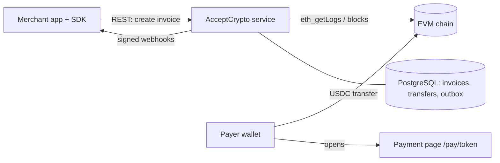
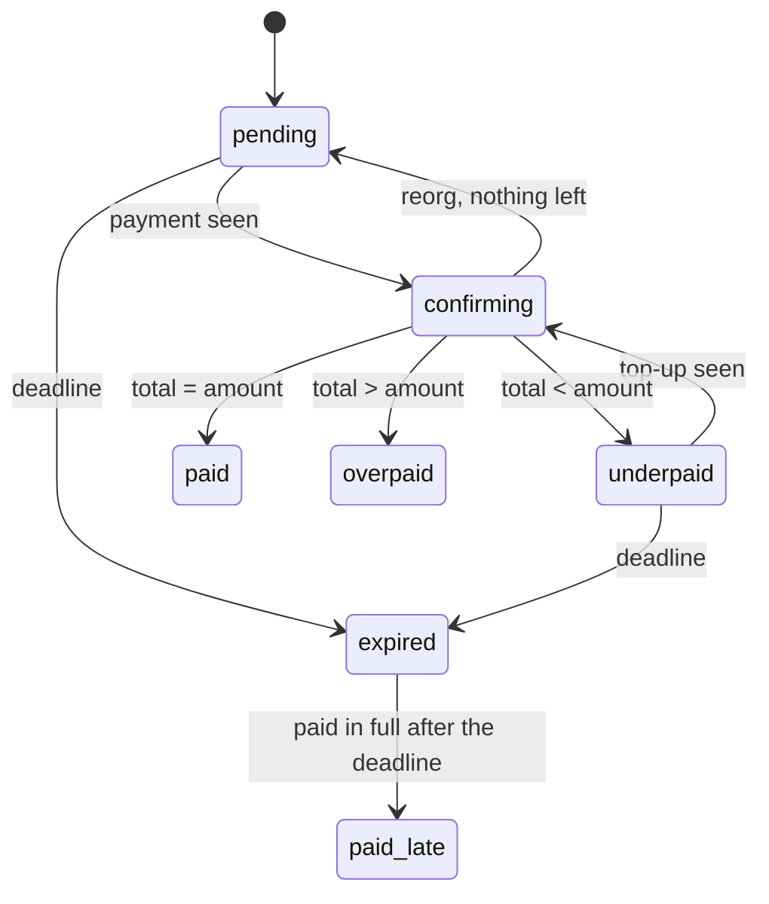

# dev.to article — draft

- **Title:** Accepting USDC in a .NET app
- **Subtitle / description (dev.to "description", ≤ 150 chars):** A non-custodial USDC payment service and SDK for
  ASP.NET Core: deposit addresses from an xpub, a chain scanner, reorgs, and signed webhooks.
- **Tags (max 4):** `dotnet`, `csharp`, `blockchain`, `webdev` (alternatives: `aspnetcore`, `payments`, `ethereum`)
- **Series:** [SERIES NAME — the author's existing dev.to series]
- **Cover image:** [frame from the payment-cycle GIF or the testnet video]
- **Canonical URL:** [if cross-posted]

## Structure

1. Hook: what "accepting USDC" really requires beyond "send to this address"
2. The shape: a payment service + an SDK (the Stripe + Stripe.net model), with a diagram
3. Decision 1 — how a payment finds its invoice: one deposit address per invoice from an xpub
4. Decision 2 — money as integers: `UsdcAmount`
5. Reading the chain yourself: `eth_getLogs`, checkpoints, chunks
6. Confirmations and reorgs: never a false "paid"
7. Inexact payments: underpaid, overpaid, late, unmatched
8. Webhooks the merchant can trust: outbox, HMAC, retries, dedup
9. The merchant's side: the SDK in a few lines
10. Testing it: a real local chain, a forced reorg, scenario tests
11. What is deliberately not there (and why) + try it yourself

---

## Draft

*This is a portfolio project, not a production service: it runs on a local chain and on testnets only. No real money
was harmed.*

"Accept USDC" sounds like one line on a checkout page: *send 25 USDC to 0xABC…*. Then the questions arrive. Which
order does an incoming transfer belong to when fifty customers pay at the same time? What if a customer sends 24.99,
or pays in two parts, or pays an hour after the invoice expired? When is a payment *final* — and what if the block
it was in disappears? What if your shop is down when the payment service wants to tell it "paid"? And how does the
shop know that the "paid" message came from the payment service at all?

I built **AcceptCrypto.NET** to answer those questions in C#: a small payment service plus an SDK for ASP.NET Core.
This article walks through the decisions and the code that implements them. The full source, with tests for every
scenario, is on GitHub: [link].

### The shape: a service and an SDK

The model is the one every .NET developer knows from Stripe and Stripe.net:

- the **service** creates invoices, watches the chain for USDC transfers, tracks confirmations and reorgs, and sends
  signed webhooks;
- the **SDK** (NuGet package `AcceptCrypto.NET`) gives the merchant's ASP.NET Core app a typed client and one-line
  webhook verification.



Stack: .NET 10, ASP.NET Core minimal APIs, PostgreSQL with EF Core, `BackgroundService` workers, no message broker.
Locally the chain is Anvil with a 6-decimal mock USDC and a scripted payer; publicly it's Base Sepolia with Circle's
test USDC, paid from MetaMask. The whole stack starts with `docker compose up`.

### Decision 1: how does a payment find its invoice?

This is the decision everything else depends on. The common shortcuts have problems:

- **One address, unique amounts** (25.000137 USDC): breaks on partial payments and on wallets that round.
- **A contract call carrying the invoice ID**: needs a wallet connection on the payment page; plain transfers from an
  exchange don't work.

AcceptCrypto.NET gives **every invoice its own deposit address**, derived from the merchant's **extended public key
(xpub)** with BIP32 non-hardened derivation. Invoice number *i* (a database sequence) gets the address at
`m/44'/60'/0'/0/i` — the same path wallets like MetaMask use for "Account *i+1*" — so the merchant's own wallet can
see and move the funds, while the service **never holds a private key**:

```csharp
public string DeriveAddress(long index)
{
    var child = _extPubKey.Derive((uint)index);          // public derivation only
    return ToEthereumAddress(child.PubKey);              // Keccak-256 of the public key, last 20 bytes, EIP-55
}
```

Matching becomes trivial and unambiguous: a transfer to address *A* belongs to the invoice that owns *A*, whatever
the amount. Partial, over- and late payments match naturally. The cost: funds are spread across many addresses, and
moving them needs gas on each one — out of scope here, with CREATE2 forwarder contracts on the roadmap.

A safety detail: if someone pastes an `xprv` into the configuration by mistake, the service refuses it *without
echoing the value* into logs.

### Decision 2: money is an integer

USDC has 6 decimals. The domain type `UsdcAmount` is a `readonly record struct` around a `BigInteger` of base units:

```csharp
public readonly record struct UsdcAmount : IComparable<UsdcAmount>
{
    public const int Decimals = 6;
    public BigInteger BaseUnits { get; }
    // Parse("25.50") → 25_500_000 base units; strict: no exponent, at most 6 decimals, no negative values
}
```

PostgreSQL stores it as `numeric(78,0)` (fits a uint256), the API, webhooks and SDK carry amounts as **strings**
(`"25.50"`), and there is no `double` anywhere. The idempotency check even compares the canonical form, so `"10"` and
`"10.000"` are the same request.

### Reading the chain yourself

The service doesn't rely on a third-party "address activity" webhook — reading the chain is the point. A
`BackgroundService` runs a scan pass in a loop:

1. Read the chain head.
2. Check that the stored checkpoint block still has the same hash (if not: a reorg — roll the checkpoint back).
3. Re-check every *unconfirmed* transfer (more on that below).
4. Scan `[checkpoint + 1, head]` in chunks with `eth_getLogs`, filtered by the token contract, the ERC-20 `Transfer`
   topic and the deposit addresses as the `to` topic:

```csharp
var filter = new JsonObject
{
    ["fromBlock"] = ToQuantity(fromBlock),
    ["toBlock"]   = ToQuantity(toBlock),
    ["address"]   = token.ToLowerInvariant(),
    ["topics"]    = new JsonArray(TransferTopic, null, toTopics),  // any sender, only our addresses
};
var result = await CallAsync("eth_getLogs", [filter], cancellationToken);
```

The checkpoint (block number + hash) is persisted after every chunk, so after downtime the scanner resumes where it
stopped and loses nothing. RPC providers limit the block range of `eth_getLogs` — Base Sepolia's public endpoint,
for example, answered *"eth_getLogs is limited to a 200 range"* when I tried more. The chunk size is configuration,
and if a provider still rejects a range, the scanner halves it down to a single block.

**Never count a transfer twice.** A transfer's identity is `(chain_id, tx_hash, log_index)`. The domain answers
`Duplicate` for a known one, and the database has a unique index on it, so re-scanning any range — after a restart,
a lost checkpoint, a reorg rollback — changes nothing.

### Confirmations and reorgs: never a false "paid"

A transfer seen in the latest block is not final: the block can be replaced (a chain reorganization). So the invoice
goes to **`confirming`** first, and to `paid` only after **N confirmations** (configurable).

Until then, every pass re-reads the block of each unconfirmed transfer. If the block at that height now has a
different hash, the transfer is **reverted**: the invoice moves back (`confirming → pending` or `→ underpaid`), the
merchant gets a `payment.reverted` event, and the next scan starts a safe distance below, so a transaction that was
re-included in another block is found again. Two rules keep this honest: *only positive evidence reverts* (a lagging
node that doesn't know the block yet is not a reorg), and *nothing confirms without a matching hash*.

This is tested against a **real forced reorg** on Anvil (`anvil_reorg`), which replaces the last blocks and drops the
payment transaction: the test asserts the invoice goes back to `pending`, the merchant receives `payment.reverted`,
and `paid` never happens.

### Inexact payments are first-class

The invoice is a small state machine in a dependency-free domain project:



- **Underpaid** keeps the invoice open for a top-up; two partial transfers that add up exactly end in `paid`.
- **Overpaid** is terminal — the merchant decides what to do with the excess.
- **On time** is decided by the **block timestamp**, not by when the service noticed: a transfer mined before the
  deadline counts as on time even if its confirmations finish later — and even if the service was down at the
  deadline. The expiry worker only expires invoices whose deadline the scanner has already scanned past.
- **Late** full payment → `paid_late`, the merchant decides whether to honour it.
- A transfer to a closed invoice's address is recorded as an **unmatched payment** and listed via the API, so it can
  be reconciled by hand.

Every transition is an event for the merchant, which leads to the part most payment integrations get wrong.

### Webhooks the merchant can trust

**Atomicity.** A status change and its webhook event are written in one transaction: the invoice row, its transfers
and one outbox row per domain event go through a single `SaveChanges`. No status without an event, no event without
a status. Concurrent writers (scanner, expiry worker, API) are handled with optimistic concurrency: a version token,
reload and re-apply the pure domain operation on conflict.

**Delivery.** A dispatcher claims due outbox rows with `FOR UPDATE SKIP LOCKED` plus a lease (safe with several
instances), delivers events of one invoice in causal order, and retries with exponential backoff and jitter within
a configurable limit and window (about a day by default, minutes for the demo). After that the event is marked
`failed` and can be resent through the API — with the **same event ID**.

**Authenticity.** Each request carries `AcceptCrypto-Event-Id`, `AcceptCrypto-Timestamp` and
`AcceptCrypto-Signature: v1=<hex>` — an HMAC-SHA256 over `{timestamp}.{raw body}`. The receiver compares in constant
time, rejects timestamps outside a tolerance window (5 minutes by default) to stop replays, and drops duplicates by
event ID. During secret rotation the service signs with both secrets, and the SDK accepts either.

The SSRF angle is easy to forget: the webhook URL is configurable, so the service refuses internal addresses —
including after DNS resolution, checked on the IP it actually connects to — unless a host is explicitly allowlisted
(the demo shop on the Docker network).

### The merchant's side: a few lines

```csharp
builder.Services.AddAcceptCrypto();   // binds "AcceptCrypto": BaseUrl, ApiKey, WebhookSecret

app.MapPost("/checkout/{orderId}", async (string orderId, IAcceptCryptoClient acceptCrypto) =>
{
    var invoice = await acceptCrypto.CreateInvoiceAsync(
        new CreateInvoiceRequest { Amount = UsdcAmount.Parse("25.00"), ExternalOrderId = orderId },
        idempotencyKey: $"order-{orderId}");
    return Results.Redirect(invoice.PaymentPageUrl.ToString());
});

app.MapAcceptCryptoWebhook("/webhooks/acceptcrypto", async (AcceptCryptoEvent e) =>
{
    if (e is InvoiceStatusChangedEvent { Status: InvoiceStatus.Paid or InvoiceStatus.PaidLate } paid)
        await MarkOrderPaidAsync(paid.Invoice.ExternalOrderId);
});
```

The client covers every API operation; service errors (RFC 9457 Problem Details) surface as typed exceptions;
webhooks arrive as typed events, already verified and de-duplicated. The payer sees a public payment page —
addressed by an unguessable token, showing network, token, address, exact amount, deadline and a QR code, with a
live status — and never sees the merchant's order ID or metadata.

### Testing it

Unit tests cover the domain (money parsing, every edge of the state machine, a test that the transition table equals
the diagram). Integration tests run on **a real PostgreSQL and a real local chain**, and the end-to-end scenario
tests start the real service and a merchant app built on the SDK, then drive them over HTTP:

- exact payment → `paid` → webhook received;
- under-, over-, split and late payments;
- the service stopped during a payment → found after restart and counted once;
- a forced reorg → rolled back, never `paid`;
- the merchant app down → webhook delivered once it's back;
- forged, tampered and replayed webhooks → rejected;
- a transfer to a closed invoice → in the unmatched list.

The README maps each "hard part" to the test that proves it.

### What's deliberately not there

No mainnet and no real money — this is a portfolio project. One merchant, one chain and one token per deployment.
No sweeping of deposit addresses (that would need keys), no refunds, no fiat conversion, no wallet connection on the
payment page yet. Each is a conscious line in the scope, listed in the roadmap.

### Try it

```bash
git clone https://github.com/alena-dev-soft/accept-crypto-net
cd accept-crypto-net
docker compose up --build        # shop on :5080, service on :5052, local chain, PostgreSQL
```

Buy something in the demo shop, then pay with the scripted payer (`docker compose run --rm payer <payment page URL>`)
and watch the page go *confirming → paid* while the shop logs the signed webhooks. The testnet guide in
`docs/testnet.md` does the same on Base Sepolia with MetaMask.

[Closing line in the author's voice + call to action, e.g. "If you need crypto payments in your .NET app, …" with the
Upwork / Project Catalog link.]

---

## Notes for the author before publishing

- [ ] Replace `[link]`, series name, cover image, closing line.
- [ ] Code excerpts are shortened from `XpubDepositAddressDeriver.cs`, `UsdcAmount.cs`, `ChainRpcClient.cs` and the
      SDK README; re-check them against the current code.
- [ ] dev.to renders Mermaid only in some setups — if not, replace both diagrams with images (screenshots of the
      README's rendered diagrams).
- [ ] Optional: embed the video or the payment-cycle GIF after the intro.
