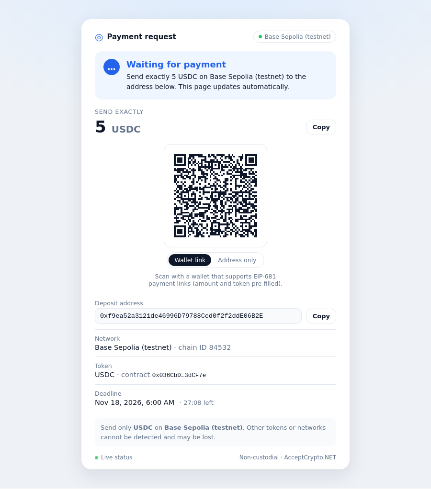

# Public testnet: Base Sepolia + Circle test USDC + MetaMask

The local stack (`docker compose up`, Anvil + mock USDC + scripted payer) is the default and the Definition of done.
This guide is the **optional** public-testnet run (DECISIONS.md D2, D9): the same service and demo shop, but the
chain is **Base Sepolia** and the payer pays **Circle's test USDC from MetaMask**. It is what the 1–2 minute video is
recorded with (last section).

> ⚠ **Testnet only.** Use a wallet and a mnemonic created for testing. Never put a mnemonic, xpub or private key of a
> wallet that holds real (mainnet) funds anywhere near this project. Test USDC and test ETH have no value.

Everything runs on your machine except the chain: the service reads Base Sepolia through an RPC endpoint, MetaMask
sends the transfer, the webhook goes from the service to the demo shop on the Docker network. Nothing has to be
reachable from the internet.

## 0. The profile at a glance

| Setting | Value | Where it comes from |
| --- | --- | --- |
| Chain ID | `84532` | Base docs, [Connect to Base](https://docs.base.org/get-started/connect-to-base) |
| USDC (Circle, 6 decimals) | `0x036CbD53842c5426634e7929541eC2318f3dCF7e` | Circle docs, [USDC contract addresses → Testnet → Base Sepolia](https://developers.circle.com/stablecoins/usdc-contract-addresses) |
| RPC URL | env `BASE_SEPOLIA_RPC_URL` → `Chain__RpcUrl` | your choice (step 1), never committed |
| Confirmations N | `60` (≈ 12 s, see "What to watch out for") | profile, override `CHAIN_CONFIRMATIONS` |
| `eth_getLogs` block range | `200` | limit of the public RPC (step 1), override `CHAIN_MAX_BLOCK_RANGE` |
| Reorg rollback depth | `300` blocks | profile |
| Poll interval | 4 s | profile (gentler on rate-limited RPCs than the local 2 s) |
| Start block | not set → the chain head at the first start | the checkpoint is persisted afterwards (FR-9) |

Files:

- [`src/AcceptCrypto.Service/appsettings.BaseSepolia.json`](../src/AcceptCrypto.Service/appsettings.BaseSepolia.json) —
  the profile, loaded with `ASPNETCORE_ENVIRONMENT=BaseSepolia`. No secrets in it.
- [`docker-compose.base-sepolia.yml`](../docker-compose.base-sepolia.yml) — PostgreSQL + service + demo shop (no Anvil).
- [`base-sepolia.env.example`](../base-sepolia.env.example) — the variables you fill in; your copy `base-sepolia.env`
  is git-ignored (`*.env`).

The token address and decimals were checked against the chain when the profile was written (`decimals()` = 6,
`symbol()` = `USDC`); the service also verifies `eth_chainId` = 84532 before it scans.

## 1. Get an RPC endpoint

The service needs one HTTPS JSON-RPC URL for Base Sepolia (it uses `eth_chainId`, `eth_blockNumber`,
`eth_getBlockByNumber`, `eth_getLogs`).

- **Quickest:** the public endpoint `https://sepolia.base.org`. Base documents its public endpoints as free, rate
  limited and best effort, not for production. When this guide was written it answered `eth_getLogs` over more than
  200 blocks with *"eth_getLogs is limited to a 200 range"* — hence `MaxBlockRange = 200` in the profile.
- **More reliable:** a free endpoint from an RPC provider (Alchemy, QuickNode, Infura, Chainstack, …): create an app
  for *Base Sepolia* and copy its HTTPS URL. Check the provider's documented `eth_getLogs` block-range limit for your
  plan and set `CHAIN_MAX_BLOCK_RANGE` to it.

A provider URL usually **contains your API key** — treat it as a secret: it goes only into `base-sepolia.env`
(or your shell), never into git, screenshots or the video. The service never logs the RPC URL (D14).

If the configured range is still too big, the scanner halves it on a JSON-RPC error down to one block (D14), so a
wrong value costs extra calls, not missed payments.

## 2. Create the merchant xpub (your own test wallet)

The service derives one deposit address per invoice from an **extended public key** (xpub) at `m/44'/60'/0'/0`
(D1, D13): invoice *i* → address `m/44'/60'/0'/0/i`. It never sees a private key. MetaMask does not display an xpub,
so the repository has an offline helper:

```bash
# Option A — generate a fresh TEST mnemonic and its xpub (prints the 12 words once: store them offline)
dotnet run --project src/AcceptCrypto.Payer -- xpub new

# Option B — you already have a TEST-ONLY mnemonic (e.g. a separate MetaMask test profile)
read -rs MERCHANT_MNEMONIC && export MERCHANT_MNEMONIC   # paste, Enter; not echoed, not in shell history
dotnet run --project src/AcceptCrypto.Payer -- xpub
unset MERCHANT_MNEMONIC
```

Output: the `xpub…` for `MERCHANT_XPUB` and the first deposit addresses (#0, #1, #2). The helper refuses the
public test mnemonics of the local stack and never prints a mnemonic you pass in.

Rules:

- **A dedicated merchant mnemonic**, not the wallet you pay from. Keep it separate from anything with mainnet funds.
- If you import the merchant mnemonic into MetaMask (e.g. a second browser profile), deposit address #*i* is
  MetaMask **"Account *i+1*"** — that is how you see (and could move) the received test USDC. Moving funds out needs a
  little test ETH on that address (sweeping is out of MVP scope, D1).
- Invoice numbers start at 0 in a new database. **After `docker compose … down -v`** (database wiped) the next
  invoices reuse addresses #0, #1, … — **generate a new mnemonic/xpub after a reset**, otherwise old transfers and
  new invoices share addresses.
- Paste only the **xpub**. The service rejects an `xprv`/`tprv` without echoing it.

## 3. Fund the payer wallet (MetaMask) from faucets

The payer is a normal MetaMask account (a test account, separate from the merchant mnemonic). It needs:

1. **Base Sepolia network in MetaMask.** Enable test networks; if Base Sepolia is not offered, add it manually with
   the values from the Base docs: RPC `https://sepolia.base.org`, chain ID `84532`, currency `ETH`, explorer
   `https://sepolia.basescan.org`.
2. **Test ETH for gas** — one transfer costs a tiny amount. The Base docs list the faucets on
   [Network faucets](https://docs.base.org/base-chain/network-information/network-faucets) (Coinbase Developer
   Platform, Alchemy, QuickNode, thirdweb, …); several require an account or a captcha, and all of them have
   per-address/per-day limits.
3. **Test USDC** — Circle's faucet [faucet.circle.com](https://faucet.circle.com): choose *USDC* and *Base Sepolia*,
   paste the MetaMask address. When this guide was written the page stated 20 USDC per request, every 2 hours per
   address and chain — limits change, check the page. That is why the demo uses the cheapest product (sticker pack,
   5.00 USDC).
4. **Show the token in MetaMask:** *Import tokens* → contract `0x036CbD53842c5426634e7929541eC2318f3dCF7e`
   (symbol USDC, 6 decimals).

## 4. Start the stack against Base Sepolia

Requires Docker. Stop the local stack first (same ports 5052/5080/5432): `docker compose down`.

```bash
cp base-sepolia.env.example base-sepolia.env
# edit base-sepolia.env:
#   BASE_SEPOLIA_RPC_URL     step 1
#   MERCHANT_API_KEY         openssl rand -hex 32
#   MERCHANT_WEBHOOK_SECRET  openssl rand -hex 32
#   MERCHANT_XPUB            step 2
docker compose -f docker-compose.base-sepolia.yml --env-file base-sepolia.env up --build
```

Check it:

```bash
curl -s localhost:5052/health/ready     # chain-scanner: head_block, last_scanned_block, lag_blocks ≈ 0
curl -s localhost:5052/metrics | grep acceptcrypto_scanner_lag_blocks
```

The startup log line `Merchant configured: … chain 84532 (Base Sepolia (testnet)), 60 confirmations, scanner
enabled: True` confirms the profile. A small `lag_blocks` that comes and goes is normal: the chain makes several
blocks per second and the scanner polls every 4 s.

Without Docker (PostgreSQL on localhost, .NET 10 SDK):

```bash
export ASPNETCORE_ENVIRONMENT=BaseSepolia
export ConnectionStrings__AcceptCrypto="Host=localhost;Port=5432;Database=acceptcrypto_testnet;Username=postgres;Password=postgres"
export Persistence__MigrateOnStartup=true
export Chain__RpcUrl=...  Merchant__ApiKey=...  Merchant__WebhookSecret=...  Merchant__Xpub=...
export Merchant__WebhookUrl=http://localhost:5080/webhooks/acceptcrypto  Webhooks__AllowedHosts__0=localhost
dotnet run --no-launch-profile --project src/AcceptCrypto.Service --urls http://localhost:5052
```

`--no-launch-profile` matters: `launchSettings.json` would switch the environment back to `Development` (Anvil).
Start the demo shop with `AcceptCrypto__BaseUrl=http://localhost:5052`, the same API key / webhook secret and
`Shop__PayerCommand=` (empty hides the local scripted-payer hint).

## 5. Pay from MetaMask

1. Open the shop `http://localhost:5080`, buy the **sticker pack (5.00 USDC)** → you land on the payment page
   (`/pay/{token}`): network *Base Sepolia (testnet)*, chain ID 84532, token USDC with contract `0x036C…CF7e`,
   the deposit address, the exact amount, the deadline and a QR code.

   

2. Pay, either way:
   - **MetaMask mobile:** scan the QR ("Wallet link" = EIP-681 link with token, amount and chain pre-filled; whether
     every field is pre-filled depends on the wallet version — check the amount before you confirm).
   - **MetaMask extension:** Send → paste the deposit address (Copy button) → asset **USDC** → amount exactly
     `5` → confirm.
3. Watch the payment page: *Waiting for payment* → **confirming** (the transfer is seen, fewer than N confirmations)
   → **paid** after N blocks. The shop's order page shows the webhooks it received, each
   signature-verified by the SDK (`invoice.confirming`, then `invoice.paid`).
4. Optional, the other scenarios on the testnet: send `3` (→ `underpaid`), then `2` more (→ `paid`);
   send more than the amount (→ `overpaid`); send USDC again to the deposit address of an already paid invoice
   (→ listed by `GET /v1/unmatched-payments`, S7). A transfer to an address that is not a deposit address is not
   watched at all (D14).

Paying without MetaMask: the scripted payer works on any chain with your own key — **only a dedicated test account**:
`PAYER_PRIVATE_KEY=0x… dotnet run --project src/AcceptCrypto.Payer -- http://localhost:5052/pay/<token> --rpc "$BASE_SEPOLIA_RPC_URL"`
(token address and amount come from the invoice; it refuses the well-known Anvil key on non-local chains).

## What to watch out for

- **Block speed and N.** Measured while writing this guide (Nov 2026): 1,000 Base Sepolia blocks took 200 seconds,
  i.e. ≈ 5 blocks per second. N = 60 therefore means ≈ 12 s of *confirming* — visible in the video, short to wait.
  N counts blocks, not seconds: if the block time changes, adjust `CHAIN_CONFIRMATIONS`. For an L2 the stronger
  notion of finality is L1 settlement (`safe`/`finalized` block tags) — on the roadmap, not used by the MVP.
- **Confirmation delays.** The page switches to *confirming* only after the scanner sees the transfer (next poll,
  ≤ 4 s, plus RPC latency) and to *paid* after N more blocks. MetaMask's own "confirmed" comes earlier — that is
  inclusion, not the service's N.
- **RPC limits.** Public/free endpoints limit both the request rate and the `eth_getLogs` range. Symptoms:
  `consecutive_failures` in `/health/ready`, rising `lag_blocks`, warnings in the log. The scanner backs off and
  retries (NFR-4); nothing is lost, the checkpoint stays where it was. Fix: a provider endpoint and its documented
  `CHAIN_MAX_BLOCK_RANGE`.
- **Downtime catch-up.** After a stop the scanner resumes from its persisted checkpoint (FR-9). At ≈ 5 blocks/s one
  hour is ≈ 18,000 blocks, i.e. ≈ 90 `eth_getLogs` chunks of 200 — fine for a provider endpoint, may hit the public
  endpoint's rate limit (it then simply takes longer).
- **First start = current head.** Transfers made *before* the first start of a fresh database are not scanned
  (`StartBlock` unset). Create invoices only after the service is up.
- **Deadline vs block time.** "On time" is decided by the **block timestamp** (D11). Default invoice lifetime is
  30 min; the shop's short-lifetime option gives 2 min for an expiry demo.
- **Wrong network / token.** Only Circle's USDC at the address above on chain 84532 is detected. Another token, or
  USDC on another chain, is not seen (the page says so).
- **Secrets on screen.** `base-sepolia.env`, a provider RPC URL, the merchant mnemonic and MetaMask's secret phrase
  must never appear in a screenshot or recording.

## Recording the 1–2 minute video

Goal (spec, "Packaging for Upwork"): **create an invoice → pay from MetaMask on testnet → status changes → webhook
arrives**, in 1–2 minutes, no cuts that hide the waiting except where noted.

**Prepare (not recorded):**

1. Steps 1–4 done; MetaMask payer on Base Sepolia with test ETH and ≥ 5 test USDC; USDC token imported.
2. Stack running and caught up (`lag_blocks` ≈ 0). Fresh order list: `docker compose -f docker-compose.base-sepolia.yml --env-file base-sepolia.env down -v` + new xpub, or just accept older orders in the list.
3. Browser: one window with tabs *Shop* (`localhost:5080`) and later the payment page; MetaMask extension pinned.
   Optionally a terminal with `docker compose … logs -f service` (shows the scanner and the webhook delivery lines).
   Close everything that shows `base-sepolia.env` or keys. Zoom the browser to ~125 % for readability.
4. Recorder: any screen recorder (e.g. OBS Studio, or the OS built-in one), 1080p, 30 fps, microphone optional.

**Scenario (≈ 90 s):**

| Time | Screen | What happens / what to say |
| --- | --- | --- |
| 0:00–0:10 | Shop catalog | "A .NET shop that accepts USDC through AcceptCrypto.NET. Non-custodial, Base Sepolia testnet." |
| 0:10–0:20 | Click *Buy* on the sticker pack | The shop creates the invoice through the SDK (`CreateInvoiceAsync`) and redirects to the payment page. |
| 0:20–0:30 | Payment page | Point at network, token contract, deposit address (unique per invoice), exact amount, deadline, QR. |
| 0:30–0:50 | MetaMask: Send → paste address → USDC → 5 → Confirm | The payer pays from an ordinary wallet; no wallet connection needed. |
| 0:50–1:05 | Payment page | Status changes to **confirming** (seen on-chain, counting N confirmations), then **paid**. Cut the wait if the RPC is slow. |
| 1:05–1:20 | Shop order page | The order is paid; the webhook list shows `invoice.confirming` and `invoice.paid` with their event IDs, verified by the SDK. |
| 1:20–1:30 | Optional: block explorer tab with the tx; or the terminal log | "Detection, confirmations, reorg handling and signed, retried webhooks — all in C#. Link in the description." |

**After recording:** check that no secret is visible in any frame; trim; export MP4. Screenshots for the Upwork
card/article can be taken from the same run (see `docs/marketing/upwork-portfolio-card.md`).
